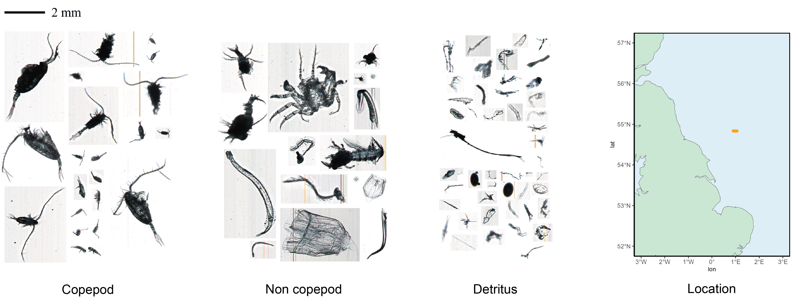

# ViT-LASNet: Improving in situ real-time classification of long-tail marine plankton images for ecosystem studies

Plankton images from in situ imagers are dominated by a few common classes (detritus, copepods), while many ecologically important classes are rare. ViT-LASNet fine-tunes pretrained Vision Transformers (ViT, BEiT) on images from the Plankton Imager (Pi-10) and handles this long tail with **dynamic Label-Aware Smoothing (LAS)**. The smoothing factor for each class depends on its frequency, and is further scaled by the ViT's attention scores, so the model's confidence follows the image regions it attends to.

- **Paper:** [ViT-LASNet (Springer)](https://link.springer.com/chapter/10.1007/978-3-031-92387-6_8)
- **Project page:** <https://alan-turing-institute.github.io/ViT-LASNet/>
- **Model weights:** [Hugging Face: Noushineft/ViT-LASNet](https://huggingface.co/Noushineft/ViT-LASNet) (ViT, BEiT and ResNet18 models, with a model card)



## Repository layout

| Path | What it does |
| --- | --- |
| `tools/loss.py` | Long-tail losses: cross-entropy variants, logit adjustment (`Bal_CE`), `BCE`, `LDAM`, `LADE`, class-balanced CE, MiSLAS label-aware smoothing and the attention-aware `MiSLAS_vit` used by ViT-LASNet |
| `tools/training.py` | Shared ViT/BEiT fine-tuning loop |
| `train/train.py` | Fine-tune ViT or BEiT over a grid of losses, learning rates and epochs |
| `train/train_nested_cv.py` | Nested cross-validation for loss and hyperparameter selection |
| `train/train_resnet.py` | ResNet18 baselines (RGB or greyscale, optional class-weighted loss) |
| `test/test.py` | Classify TIFF images with a trained ResNet, ViT or BEiT and write predictions to CSV |
| `tools/evaluate.py` | Classification reports, confusion matrices and top-3 accuracy from prediction CSVs |
| `tools/plot_radar_chart.py` | Radar charts that compare precision, recall and F1 across models |
| `EDA/eda.py` | Class distribution and t-SNE overview of a dataset |
| `xAI/grad_cam_resnet.py` | Grad-CAM explanations for ResNet18 models |

## Installation

Requires Python 3.9 or newer.

```bash
git clone https://github.com/alan-turing-institute/ViT-LASNet.git
cd ViT-LASNet
python -m venv .venv && source .venv/bin/activate
pip install -r requirements.txt
```

## Data

Training scripts expect the torchvision `ImageFolder` layout, with one folder per class:

```
data/train/
├── Detritus/
├── Zoo_crustacea_copepod/
└── ...
```

`train/train_resnet.py` expects `data/split/train/` and `data/split/test/`, each with that layout. The Pi-10 dataset is not distributed with this repository.

## Usage

Run all commands from the repository root. Every script has `--help`.

**Fine-tune ViT with dynamic label-aware smoothing (the ViT-LASNet setting):**

```bash
python train/train.py --data-dir data/train --output-dir runs/vit \
    --model vit --loss MiSLAS_vit --lr 5e-5 --epochs 30
```

To compare losses, pass several: `--loss ST_CE Bal_CE LDAM MiSLAS MiSLAS_vit`. Use `--model beit` for BEiT.

**Nested cross-validation:**

```bash
python train/train_nested_cv.py --data-dir data/train --output-dir runs/cv --epochs 30
```

**ResNet18 baseline:**

```bash
python train/train_resnet.py --data-dir data/split --output-dir runs/resnet --gray --weighted-loss
```

**Predict:**

```bash
# ViT-LASNet (18 classes), downloaded from Hugging Face; top-3 predictions for every TIFF in a folder
python test/test.py -m 2 -n 18 -k 3 -w Noushineft/ViT-LASNet/vit-mislas \
    -f path/to/images -o results/vit_topthree.csv
```

`-w` takes a local weights path or a Hugging Face model as `<user>/<repo>/<sub-folder>`. The published sub-folders are `vit-mislas`, `beit-balce`, `vit-balce-3class`, `resnet18-18class-rgb` and `resnet18-3class-rgb`. `-m` selects the model (0 = ResNet50, 1 = ResNet18, 2 = ViT, 3 = BEiT). For ResNet weights, add `-g` if the model was trained on greyscale images. See [`test/README.md`](test/README.md) for more examples.

**Evaluate:**

```bash
python tools/evaluate.py --predictions-dir results --labels-csv labels.csv --output-dir results/eval
```

`labels.csv` needs `Filename` and `Label` columns.

## Acknowledgements

Developed at The Alan Turing Institute. Thanks to Jo Walsh (UKCEH) for reproducibility fixes.

## Citation

If you use this code, please cite the paper linked above.
